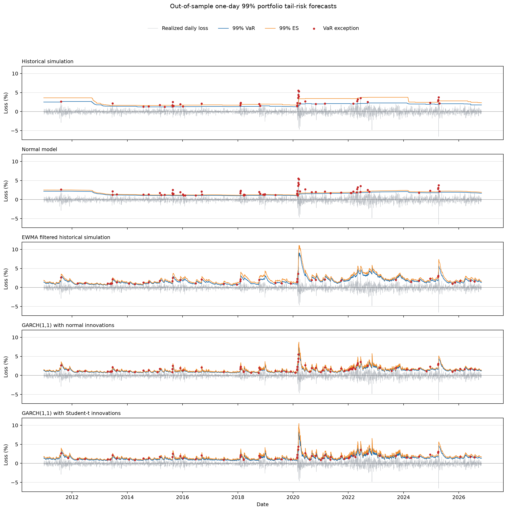

# Initial Findings: Portfolio Tail-Risk Models

## Setup

The comparison uses one-day returns for a daily rebalanced portfolio holding 60% SPY and 40% TLT. Each model uses up to the previous 1,000 trading days to forecast the next day. GARCH parameters are refreshed every 21 trading days, while its conditional variance is updated daily. The out-of-sample period runs from 2010-12-22 through 2026-10-29, covering 3,987 forecast dates.

An exception occurs when the realized loss is greater than that day's VaR forecast. A correctly calibrated 95% VaR should have an exception rate near 5%; a 99% VaR should be near 1% over a sufficiently long sample.

## VaR exception rates

| Model | 95% exceptions | 95% observed rate | 99% exceptions | 99% observed rate |
| --- | ---: | ---: | ---: | ---: |
| Historical simulation | 199 / 3,987 | 4.99% | 40 / 3,987 | 1.00% |
| Normal model | 184 / 3,987 | 4.62% | 65 / 3,987 | 1.63% |
| EWMA filtered historical simulation | 201 / 3,987 | 5.04% | 46 / 3,987 | 1.15% |
| GARCH(1,1) with normal innovations | 219 / 3,987 | 5.49% | 82 / 3,987 | 2.06% |
| GARCH(1,1) with Student-t innovations | 230 / 3,987 | 5.77% | 62 / 3,987 | 1.56% |

At the 99% level, all three parametric models record more exceptions than their 1% target. Student-t innovations reduce GARCH's 99% exceptions from 82 to 62, but the resulting 1.56% rate remains above target. Student-t GARCH has an average 99% VaR of 1.41% and ES of 1.76%, compared with 1.31% and 1.51% for normal GARCH.

The historical and EWMA models have aggregate 99% exception rates closer to 1%. That alone does not establish that either model is reliable: the exceptions are unevenly distributed through time.

## Formal VaR diagnostics and joint VaR-ES scores

The summary now includes the Kupiec unconditional-coverage test, which checks whether the exception frequency matches its target, and Christoffersen's first-order independence and conditional-coverage tests, which check whether exceptions cluster over time. The likelihood-ratio p-values use their asymptotic chi-square distributions. At the 5% level, the results are:

### 95% VaR

| Model | UC p-value | Independence p-value | Conditional-coverage p-value | Mean FZ0 score |
| --- | ---: | ---: | ---: | ---: |
| Historical simulation | 0.980 | <0.001 | <0.001 | -4.172 |
| Normal model | 0.259 | <0.001 | <0.001 | -4.144 |
| EWMA filtered historical simulation | 0.905 | 0.018 | 0.060 | -4.345 |
| GARCH(1,1) with normal innovations | 0.160 | 0.006 | 0.008 | -4.366 |
| GARCH(1,1) with Student-t innovations | 0.030 | 0.019 | 0.006 | **-4.368** |

### 99% VaR

| Model | UC p-value | Independence p-value | Conditional-coverage p-value | Mean FZ0 score |
| --- | ---: | ---: | ---: | ---: |
| Historical simulation | 0.984 | <0.001 | <0.001 | -3.611 |
| Normal model | <0.001 | <0.001 | <0.001 | -3.373 |
| EWMA filtered historical simulation | 0.341 | 0.002 | 0.005 | -3.894 |
| GARCH(1,1) with normal innovations | <0.001 | 0.008 | <0.001 | -3.841 |
| GARCH(1,1) with Student-t innovations | 0.001 | 0.018 | <0.001 | **-3.929** |

At 95%, the unconditional-coverage test rejects Student-t GARCH but not the other models at 5%; the independence test rejects every model. The combined conditional-coverage test rejects all five models. At 99%, every model fails the combined conditional-coverage test, and all but historical simulation also fail unconditional coverage. Student-t GARCH improves the GARCH exception count at 99%, but it is still significantly above the 1% target.

The FZ0 column is the mean joint VaR-ES score for positive loss forecasts; a lower score is better. Student-t GARCH has the lowest mean score at both levels, though the 95% score is nearly tied with normal GARCH and the 99% score is close to EWMA. These sample averages do not show whether the differences are statistically meaningful, so the next section reports paired score tests. GARCH specifies a constant conditional mean and GARCH(1,1) variance, estimated by maximum likelihood as described in the [`arch` documentation](https://arch.readthedocs.io/en/stable/univariate/univariate_volatility_modeling.html). Student-t innovations use the unit-variance parameterization in the [`arch` `StudentsT` reference](https://arch.readthedocs.io/en/stable/univariate/generated/arch.univariate.StudentsT.html). The joint VaR-ES score follows [Fissler, Ziegel, and Gneiting](https://arxiv.org/abs/1507.00244); the coverage tests follow [Kupiec](https://fedinprint.org/item/fedgfe/34596/original) and [Christoffersen](https://users.ssc.wisc.edu/~bhansen/718/Christoffersen1998.pdf).

## Paired FZ0 score comparisons

The daily score differences are paired on the same 3,987 forecast dates. The table reports Student-t GARCH's score minus the comparator's score, so a negative value favors Student-t GARCH. A Newey-West heteroskedasticity-and-autocorrelation consistent (HAC) mean test uses 20 lags; p-values are asymptotic two-sided normal approximations. Holm adjustment controls the familywise error rate across the four comparisons.

| Confidence level | Comparison | Mean score difference | Test statistic | Raw p-value | Holm-adjusted p-value |
| --- | --- | ---: | ---: | ---: | ---: |
| 95% | Student-t GARCH minus normal GARCH | -0.0024 | -1.056 | 0.291 | 0.580 |
| 95% | Student-t GARCH minus EWMA-FHS | -0.0230 | -1.654 | 0.098 | 0.294 |
| 99% | Student-t GARCH minus normal GARCH | -0.0872 | -3.878 | <0.001 | **<0.001** |
| 99% | Student-t GARCH minus EWMA-FHS | -0.0343 | -1.058 | 0.290 | 0.580 |

After Holm adjustment, the 99% FZ0 score is lower for Student-t than normal GARCH (adjusted p=0.0004). The differences from normal GARCH at 95% and from EWMA-FHS at either level are not statistically significant at 5%. These tests compare average joint scores and do not replace the VaR calibration diagnostics; in particular, the Student-t model still has too many 99% exceptions.

## Performance by volatility regime

For each forecast date, I calculate annualized volatility from the previous 20 trading days. The high-volatility cutoff is the 75th percentile of those volatility estimates during the initial 1,000-day training window: 13.04% annualized. Each forecast is labeled using information available before that forecast. This leaves 3,428 lower-volatility dates and 559 high-volatility dates in the out-of-sample period. The lower-volatility group is everything at or below the cutoff; it does not necessarily mean markets were calm in an absolute sense.

The tables show exception counts and rates alongside mean FZ0 scores. Lower scores are better when comparing models within the same confidence level and regime.

### 95% VaR and ES

| Model | Lower-volatility exceptions | High-volatility exceptions | Lower-volatility FZ0 | High-volatility FZ0 |
| --- | ---: | ---: | ---: | ---: |
| Historical simulation | 137 / 3,428 (4.00%) | 62 / 559 (11.09%) | -4.310 | -3.324 |
| Normal model | 128 / 3,428 (3.73%) | 56 / 559 (10.02%) | -4.300 | -3.187 |
| EWMA filtered historical simulation | 182 / 3,428 (5.31%) | 19 / 559 (3.40%) | -4.440 | -3.760 |
| GARCH(1,1) with normal innovations | 196 / 3,428 (5.72%) | 23 / 559 (4.11%) | **-4.446** | **-3.873** |
| GARCH(1,1) with Student-t innovations | 207 / 3,428 (6.04%) | 23 / 559 (4.11%) | **-4.449** | -3.868 |

### 99% VaR and ES

| Model | Lower-volatility exceptions | High-volatility exceptions | Lower-volatility FZ0 | High-volatility FZ0 |
| --- | ---: | ---: | ---: | ---: |
| Historical simulation | 26 / 3,428 (0.76%) | 14 / 559 (2.50%) | -3.842 | -2.195 |
| Normal model | 47 / 3,428 (1.37%) | 18 / 559 (3.22%) | -3.770 | -0.936 |
| EWMA filtered historical simulation | 44 / 3,428 (1.28%) | 2 / 559 (0.36%) | -3.982 | -3.354 |
| GARCH(1,1) with normal innovations | 72 / 3,428 (2.10%) | 10 / 559 (1.79%) | -3.892 | -3.529 |
| GARCH(1,1) with Student-t innovations | 56 / 3,428 (1.63%) | 6 / 559 (1.07%) | **-3.991** | **-3.546** |

In high-volatility periods, historical and normal models exceed their exception-rate targets at both levels. Both GARCH variants have a 4.11% 95% exception rate in the high-volatility group; at 99%, normal GARCH is 1.79% and Student-t GARCH is 1.07%, compared with EWMA at 0.36%. Student-t GARCH has the lowest 99% FZ0 score in both regimes, while its 95% score is close to normal GARCH. These subgroup rates and score rankings are descriptive; the paired tests above cover the full period, and high-volatility 99% results contain only 2 to 18 exceptions per model.

## Sensitivity to rolling-window length

I compared 500-, 1,000-, and 1,500-day estimation windows over the same evaluation dates, 2012-12-18 through 2026-10-29 (3,487 forecasts per model and window). This keeps market conditions comparable across window sizes. The tables report exception rates and mean FZ0 scores; lower FZ0 scores are better within a confidence level.

### 95% VaR and ES

| Window | Historical exceptions | Normal exceptions | EWMA exceptions | GARCH normal exceptions | GARCH Student-t exceptions | Historical FZ0 | Normal FZ0 | EWMA FZ0 | GARCH normal FZ0 | GARCH Student-t FZ0 |
| ---: | ---: | ---: | ---: | ---: | ---: | ---: | ---: | ---: | ---: | ---: |
| 500 days | 5.79% | 5.33% | 5.05% | 5.48% | 5.85% | -4.178 | -4.128 | -4.303 | -4.322 | **-4.326** |
| 1,000 days | 5.62% | 5.22% | 5.05% | 5.59% | 5.88% | -4.170 | -4.142 | -4.310 | -4.329 | **-4.331** |
| 1,500 days | 5.68% | 5.19% | 4.96% | 5.68% | 5.88% | -4.115 | -4.083 | -4.311 | -4.326 | **-4.331** |

### 99% VaR and ES

| Window | Historical exceptions | Normal exceptions | EWMA exceptions | GARCH normal exceptions | GARCH Student-t exceptions | Historical FZ0 | Normal FZ0 | EWMA FZ0 | GARCH normal FZ0 | GARCH Student-t FZ0 |
| ---: | ---: | ---: | ---: | ---: | ---: | ---: | ---: | ---: | ---: | ---: |
| 500 days | 1.23% | 1.95% | 1.26% | 2.15% | 1.78% | -3.565 | -3.301 | **-3.843** | -3.775 | -3.877 |
| 1,000 days | 1.12% | 1.84% | 1.23% | 2.24% | 1.66% | -3.609 | -3.309 | **-3.839** | -3.777 | -3.878 |
| 1,500 days | 1.00% | 2.09% | 1.06% | 2.24% | 1.81% | -3.559 | -3.243 | **-3.859** | -3.778 | -3.889 |

Both GARCH variants have similar 95% FZ0 scores across windows, with Student-t marginally lower. EWMA has the lowest 99% FZ0 score for all window sizes. Student-t reduces the 99% GARCH exception rate compared with normal GARCH, but it remains above 1% for every window. This is evidence of robustness within these choices rather than proof that one window is best.

## Exceptions by year at 99% VaR

| Year | Forecast days | Historical | Normal | EWMA filtered historical | GARCH normal | GARCH Student-t | Expected at 1% |
| --- | ---: | ---: | ---: | ---: | ---: | ---: | ---: |
| 2015 | 252 | 7 | 8 | 4 | 6 | 4 | 2.5 |
| 2018 | 251 | 5 | 12 | 3 | 9 | 6 | 2.5 |
| 2020 | 253 | 11 | 13 | 6 | 11 | 9 | 2.5 |
| 2022 | 251 | 5 | 10 | 0 | 11 | 6 | 2.5 |

Normal GARCH and Student-t GARCH both have clusters of exceptions in 2018, 2020, and 2022, though Student-t has fewer in each selected year. Historical simulation also has a cluster in 2020. EWMA has fewer exceptions in those selected years, but had six in 2013 and four in 2014; a few selected years are not enough to rank the models.

## Visual comparison

The EWMA and both GARCH models' VaR and ES respond to changing volatility, while historical simulation changes in steps as observations enter or leave its rolling window. The unconditional normal model's forecasts change more smoothly. At the 99% level, Student-t GARCH generally sets wider tail forecasts than normal GARCH.

## Limitations and next analysis

- The likelihood-ratio p-values are asymptotic. There are 40 to 82 exceptions per model at 99%, so those test results should be interpreted cautiously.
- The paired FZ0 tests use an asymptotic HAC normal approximation with 20 lags; different lag choices or bootstrap inference could change the p-values.
- A 1,000-day window contains only about 10 observations beyond a 99% empirical quantile, so 99% historical and filtered-tail estimates are noisy.
- Both GARCH specifications refresh parameters every 21 trading days. Student-t innovations allow heavier tails but remain symmetric and depend on an estimated degrees-of-freedom parameter.
- The results depend on this portfolio, daily rebalancing assumption, sample period, and data source. They do not identify a universal best model.

The next useful extension is to test whether these results carry over to a second portfolio, or to use a block bootstrap to check the uncertainty around the paired score differences.
