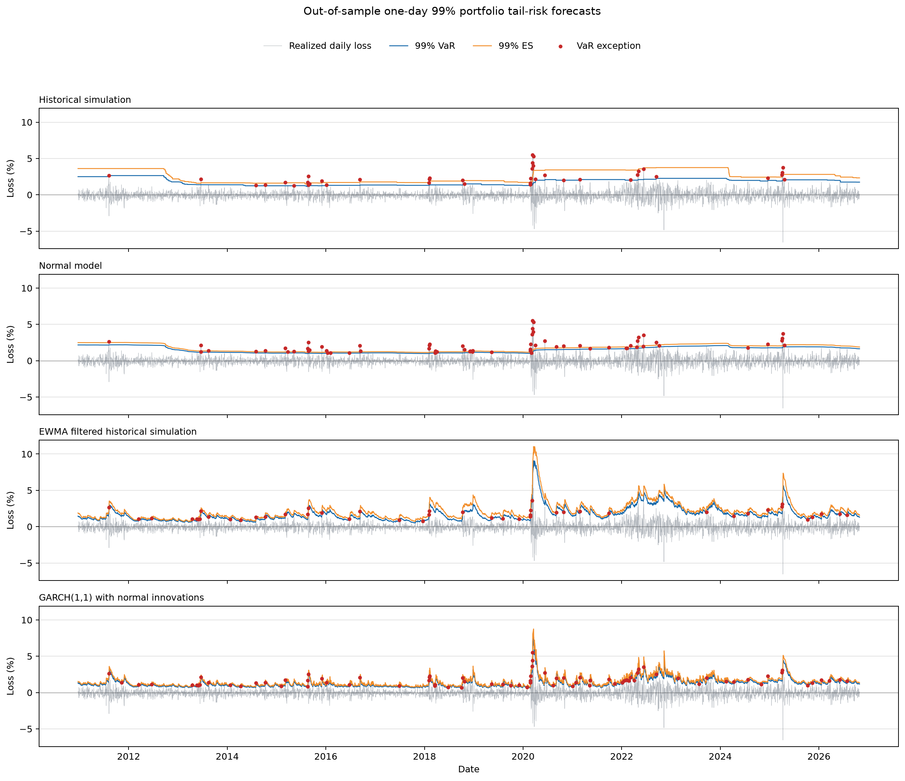

# Initial Findings: Portfolio Tail-Risk Models

## Setup

The comparison uses one-day returns for a daily rebalanced portfolio holding 60% SPY and 40% TLT. Each model is estimated from the previous 1,000 trading days and then forecasts the next day. The out-of-sample period runs from 2010-12-22 through 2026-10-29, covering 3,987 forecast dates.

An exception occurs when the realized loss is greater than that day's VaR forecast. A correctly calibrated 95% VaR should have an exception rate near 5%; a 99% VaR should be near 1% over a sufficiently long sample.

## VaR exception rates

| Model | 95% exceptions | 95% observed rate | 99% exceptions | 99% observed rate |
| --- | ---: | ---: | ---: | ---: |
| Historical simulation | 199 / 3,987 | 4.99% | 40 / 3,987 | 1.00% |
| Normal model | 184 / 3,987 | 4.62% | 65 / 3,987 | 1.63% |
| EWMA filtered historical simulation | 201 / 3,987 | 5.04% | 46 / 3,987 | 1.15% |

At the 99% level, the normal model records more exceptions than its 1% target. Its average 99% VaR is 1.51% and average ES is 1.74%, below the corresponding historical estimates of 1.79% VaR and 2.56% ES. This is consistent with the normal model understating tail risk in this sample.

The historical and EWMA models have aggregate 99% exception rates closer to 1%. That alone does not establish that either model is reliable: the exceptions are unevenly distributed through time.

## Formal VaR diagnostics and joint VaR-ES scores

The summary now includes the Kupiec unconditional-coverage test, which checks whether the exception frequency matches its target, and Christoffersen's first-order independence and conditional-coverage tests, which check whether exceptions cluster over time. The likelihood-ratio p-values use their asymptotic chi-square distributions. At the 5% level, the results are:

### 95% VaR

| Model | UC p-value | Independence p-value | Conditional-coverage p-value | Mean FZ0 score |
| --- | ---: | ---: | ---: | ---: |
| Historical simulation | 0.980 | <0.001 | <0.001 | -4.172 |
| Normal model | 0.259 | <0.001 | <0.001 | -4.144 |
| EWMA filtered historical simulation | 0.905 | 0.018 | 0.060 | **-4.345** |

### 99% VaR

| Model | UC p-value | Independence p-value | Conditional-coverage p-value | Mean FZ0 score |
| --- | ---: | ---: | ---: | ---: |
| Historical simulation | 0.984 | <0.001 | <0.001 | -3.611 |
| Normal model | <0.001 | <0.001 | <0.001 | -3.373 |
| EWMA filtered historical simulation | 0.341 | 0.002 | 0.005 | **-3.894** |

At 95%, none of the models is rejected by the unconditional-coverage test, but historical and normal exceptions are strongly dependent. EWMA's independence test also rejects at 5%; its combined conditional-coverage p-value is 0.060, just above that cutoff. At 99%, historical and EWMA exception counts are consistent with their 1% target, while the normal model has too many exceptions. All three models show dependent exceptions, so none passes the combined conditional-coverage test.

The FZ0 column is the mean joint VaR-ES score for positive loss forecasts; a lower score is better. EWMA has the lowest score at both levels in this sample. This is a comparative score, not a standalone statistical acceptance test for ES, so it does not establish that EWMA is universally best. The score follows the joint VaR and ES scoring framework of [Fissler, Ziegel, and Gneiting](https://arxiv.org/abs/1507.00244). The coverage tests follow [Kupiec](https://fedinprint.org/item/fedgfe/34596/original) and [Christoffersen](https://users.ssc.wisc.edu/~bhansen/718/Christoffersen1998.pdf).

## Performance by volatility regime

For each forecast date, I calculate annualized volatility from the previous 20 trading days. The high-volatility cutoff is the 75th percentile of those volatility estimates during the initial 1,000-day training window: 13.04% annualized. Each forecast is labeled using information available before that forecast. This leaves 3,428 lower-volatility dates and 559 high-volatility dates in the out-of-sample period. The lower-volatility group is everything at or below the cutoff; it does not necessarily mean markets were calm in an absolute sense.

The tables show exception counts and rates alongside mean FZ0 scores. Lower scores are better when comparing models within the same confidence level and regime.

### 95% VaR and ES

| Model | Lower-volatility exceptions | High-volatility exceptions | Lower-volatility FZ0 | High-volatility FZ0 |
| --- | ---: | ---: | ---: | ---: |
| Historical simulation | 137 / 3,428 (4.00%) | 62 / 559 (11.09%) | -4.310 | -3.324 |
| Normal model | 128 / 3,428 (3.73%) | 56 / 559 (10.02%) | -4.300 | -3.187 |
| EWMA filtered historical simulation | 182 / 3,428 (5.31%) | 19 / 559 (3.40%) | **-4.440** | **-3.760** |

### 99% VaR and ES

| Model | Lower-volatility exceptions | High-volatility exceptions | Lower-volatility FZ0 | High-volatility FZ0 |
| --- | ---: | ---: | ---: | ---: |
| Historical simulation | 26 / 3,428 (0.76%) | 14 / 559 (2.50%) | -3.842 | -2.195 |
| Normal model | 47 / 3,428 (1.37%) | 18 / 559 (3.22%) | -3.770 | -0.936 |
| EWMA filtered historical simulation | 44 / 3,428 (1.28%) | 2 / 559 (0.36%) | **-3.982** | **-3.354** |

In high-volatility periods, historical and normal models exceed their exception-rate targets at both levels. EWMA has fewer high-volatility exceptions than the target; in the lower-volatility group, all three models' 95% rates are close to 5%, and their 99% rates range from 0.76% to 1.37%. EWMA also has the lowest mean FZ0 score in each regime at both levels. These subgroup rates and score rankings are descriptive: no score-difference test was run, and the high-volatility 99% results contain only 2 to 18 exceptions per model.

## Sensitivity to rolling-window length

I compared 500-, 1,000-, and 1,500-day estimation windows over the same evaluation dates, 2012-12-18 through 2026-10-29 (3,487 forecasts per model and window). This keeps market conditions comparable across window sizes. The tables report exception rates and mean FZ0 scores; lower FZ0 scores are better within a confidence level.

### 95% VaR and ES

| Window | Historical exceptions | Normal exceptions | EWMA exceptions | Historical FZ0 | Normal FZ0 | EWMA FZ0 |
| ---: | ---: | ---: | ---: | ---: | ---: | ---: |
| 500 days | 5.79% | 5.33% | 5.05% | -4.178 | -4.128 | **-4.303** |
| 1,000 days | 5.62% | 5.22% | 5.05% | -4.170 | -4.142 | **-4.310** |
| 1,500 days | 5.68% | 5.19% | 4.96% | -4.115 | -4.083 | **-4.311** |

### 99% VaR and ES

| Window | Historical exceptions | Normal exceptions | EWMA exceptions | Historical FZ0 | Normal FZ0 | EWMA FZ0 |
| ---: | ---: | ---: | ---: | ---: | ---: | ---: |
| 500 days | 1.23% | 1.95% | 1.26% | -3.565 | -3.301 | **-3.843** |
| 1,000 days | 1.12% | 1.84% | 1.23% | -3.609 | -3.309 | **-3.839** |
| 1,500 days | 1.00% | 2.09% | 1.06% | -3.559 | -3.243 | **-3.859** |

EWMA has the lowest mean FZ0 score for every window size at both levels, so that ranking is stable in this comparison. At 99%, the normal model exceeds the 1% exception target for all three windows, while historical and EWMA remain closer to target. The differences in FZ0 scores are not statistically tested, and the 99% exception counts are limited, so this is evidence of robustness within these choices rather than proof that one window is best.

## Exceptions by year at 99% VaR

| Year | Forecast days | Historical | Normal | EWMA filtered historical | Expected at 1% |
| --- | ---: | ---: | ---: | ---: | ---: |
| 2015 | 252 | 7 | 8 | 4 | 2.5 |
| 2018 | 251 | 5 | 12 | 3 | 2.5 |
| 2020 | 253 | 11 | 13 | 6 | 2.5 |
| 2022 | 251 | 5 | 10 | 0 | 2.5 |

The normal model has clusters of exceptions in 2018, 2020, and 2022. Historical simulation also has a cluster in 2020. EWMA has fewer exceptions in those selected years, but had six in 2013 and four in 2014; a few selected years are not enough to rank the models.

## Visual comparison

The EWMA model's VaR and ES rise quickly around large return shocks and then decline as those shocks receive less weight. Historical simulation changes in steps as observations enter or leave its rolling window. The normal model's forecasts change more smoothly.

## Limitations and next analysis

- The likelihood-ratio p-values are asymptotic. In particular, there are only 40 to 65 exceptions at 99%, so those test results should be interpreted cautiously.
- The mean FZ0 scores rank joint VaR-ES forecasts in this sample but do not test whether score differences are statistically significant.
- A 1,000-day window contains only about 10 observations beyond a 99% empirical quantile, so 99% historical and filtered-tail estimates are noisy.
- The results depend on this portfolio, daily rebalancing assumption, sample period, and data source. They do not identify a universal best model.

The next useful extension is to compare these forecasts with a volatility model such as GARCH, while keeping the same evaluation period and scoring rules.
